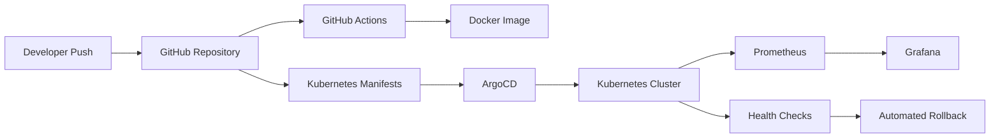

# Mid-Semester Dissertation Report

## Title
Design and Evaluation of a Secure GitOps CI/CD Pipeline with Automated Rollback using ArgoCD and Prometheus

## Student Information
- Student: Sanjay M
- Course: CSIW ZG628T – Dissertation
- Degree: MTech Computing Systems and Infrastructure
- Organization: Wipro Technologies, Bengaluru

## Executive Summary
This project explores the design and practical evaluation of a secure GitOps-based CI/CD pipeline using ArgoCD and Prometheus. The system moves away from traditional imperative deployment methods and instead uses Git as the single source of truth. Deployment decisions are automated, versioned, and auditable, which reduces configuration drift and supports faster recovery from failed releases.

The current implementation demonstrates the core GitOps flow: a Dockerized web application is containerized, deployed to a local Kubernetes cluster, exposed via a Service, and managed through ArgoCD. The system also includes health probes, Prometheus monitoring, and Grafana as a visualization layer. Together, these components establish a strong foundation for the final dissertation evaluation.

## Problem Statement
Traditional CI/CD processes often rely on push-based delivery, where application changes are deployed directly to infrastructure without a declarative, version-controlled state model. This creates several problems:

- configuration drift between Git and cluster state
- difficult rollback in the event of failed releases
- slower recovery after deployment issues
- limited observability and traceability across releases

These challenges reduce system reliability and make production deployment management harder. A GitOps approach addresses these issues by enforcing declarative infrastructure and automated reconciliation.

## Research Objectives
1. Design a GitOps pipeline using Kubernetes, Docker, ArgoCD, and GitHub Actions.
2. Evaluate the effectiveness of pull-based deployment and declarative state management.
3. Investigate how health monitoring and automated rollback improve reliability.
4. Compare GitOps-based deployment with traditional CI/CD from a recovery and maintenance perspective.
5. Produce a practical, dissertation-ready implementation and documentation.

## Research Questions
1. How can a GitOps workflow improve deployment reliability and consistency?
2. What is the role of ArgoCD in reconciling Git state to cluster state?
3. How do Prometheus and Grafana support monitoring and operational visibility?
4. How can automated rollback reduce mean time to recovery (MTTR)?
5. Which benefits and limitations arise when compared with conventional CI/CD pipelines?

## System Design

### High-Level Architecture
The proposed system follows this flow:

1. Developer pushes code to GitHub.
2. GitHub Actions builds and validates the application.
3. Docker image is built and pushed to a registry.
4. Kubernetes manifests are stored in Git.
5. ArgoCD synchronizes the desired state from Git into the cluster.
6. Prometheus collects metrics from the application and Kubernetes resources.
7. Grafana visualizes operational metrics.
8. Health checks and automated rollback mechanisms detect unhealthy deployments and revert to the previous stable state.

## Implementation Status
The project has reached a functional mid-term milestone with the following implemented components:

### Completed
- Static web application containerized with Docker
- Kubernetes Deployment and Service manifests
- Local Kubernetes cluster using kind
- Docker-based local validation
- Nginx health endpoint for readiness and liveness probes
- Prometheus deployment and config
- Grafana deployment for dashboard visualization
- ArgoCD installation in the Kubernetes cluster
- GitHub Actions workflow for image build and push

### Verified Results
The following checks were executed successfully:

- `kubectl rollout status deployment/gitops-demo --timeout=120s`
  - Result: deployment successfully rolled out
- `curl.exe -sSf http://localhost:8080/health`
  - Result: `ok`
- `kubectl get pods -n argocd`
  - Result: all ArgoCD pods were running

These results confirm that the application and core monitoring/control-plane components are operational in the local environment.

## Tools and Technologies

| Area | Technology |
|---|---|
| Version Control | Git, GitHub |
| CI | GitHub Actions |
| Containerization | Docker |
| Orchestration | Kubernetes (kind) |
| GitOps CD | ArgoCD |
| Monitoring | Prometheus, Grafana |
| Application Layer | Nginx static site |

## Why GitOps is Better for This Use Case
GitOps reduces operational risk by ensuring that the cluster state converges to the desired state stored in Git. This creates a clear audit trail, reduces manual intervention, and makes it easier to reason about deployment history. In a dissertation context, this is a strong example of declarative operations and modern DevOps practice.

## Limitations of the Current Prototype
Although the prototype is functional, it still has limitations:

- It uses a simple static website rather than a complex microservice or stateful application.
- Automated rollback logic is conceptually prepared but not yet fully implemented in production-grade form.
- Monitoring is operational but still basic and could be expanded with alert rules and dashboards.
- Continuous deployment is only demonstrated at a local prototype level rather than on a public cloud environment.

## Future Work for Final Submission
The following activities will complete the project for the final report:

1. Implement automated rollback policies based on health and metric thresholds.
2. Add explicit Prometheus alert rules for deployment failure scenarios.
3. Expand the application to include realistic health and failure conditions.
4. Create a comparison table between traditional CI/CD and GitOps.
5. Write the evaluation section with metrics such as recovery time, deployment consistency, and operational visibility.
6. Prepare a final dissertation chapter structure with abstract, methodology, implementation, evaluation, and conclusion.

## Mid-Semester Conclusion
The project is on track to satisfy the dissertation objective. The prototype demonstrates that the architecture is viable and that the GitOps workflow is technically implementable in a local Kubernetes environment. The next phase should focus on operational hardening, automated rollback, and a stronger evaluation model for the final report.

## Short Viva Response
A brief viva-ready response is:

> This project addresses the operational problems of traditional CI/CD, especially drift, slow recovery, and poor observability. The solution uses Git as the source of truth with ArgoCD for reconciliation, Kubernetes for deployment, Docker for packaging, and Prometheus/Grafana for monitoring. The current prototype has successfully validated the core deployment flow, health checks, and monitoring stack, which provides a solid base for the final implementation of automated rollback and comparative evaluation.

## Suggested Final Report Structure
1. Introduction
2. Literature Review
3. Problem Statement and Objectives
4. Proposed Architecture
5. Methodology
6. Implementation Details
7. Experimental Setup
8. Results and Evaluation
9. Discussion and Limitations
10. Conclusion and Future Work

## Deliverable Status
- Prototype implemented: Yes
- Local validation completed: Yes
- Monitoring stack active: Yes
- ArgoCD installed: Yes
- Mid-term readiness: High
